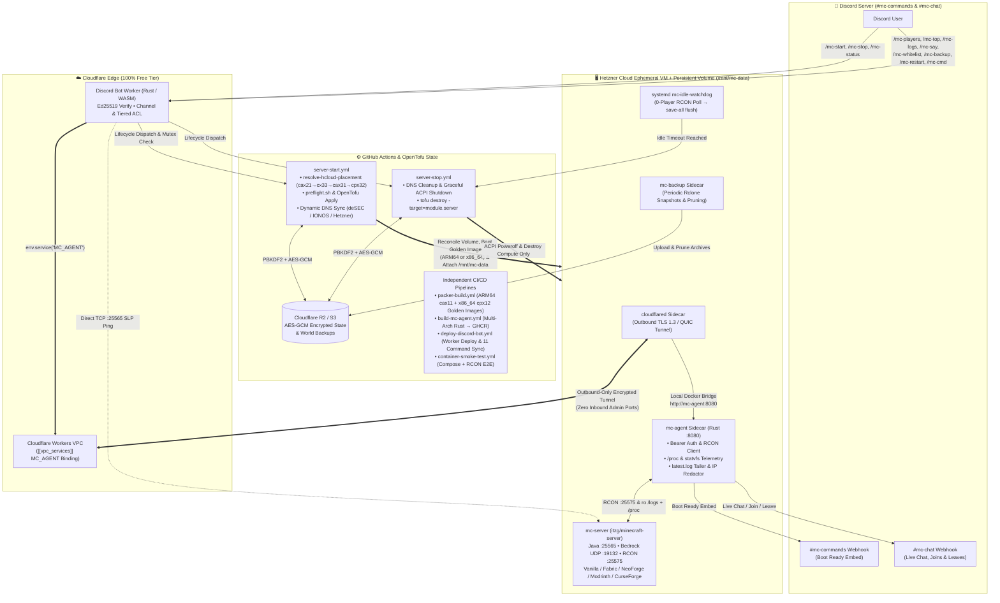

# mine-your-own-bum

[](https://github.com/bumuellp/mine-your-own-bum/actions/workflows/ci.yml)
[](https://opentofu.org/)
[](https://www.rust-lang.org/)
[](https://www.gnu.org/software/bash/)
[](LICENSE)

**Mine Your Own Bum** is a public template repository for running **on-demand, cost-optimized Minecraft servers** on Hetzner Cloud.

It combines ephemeral compute instances with persistent block volume retention, automatic idle shutdown, dynamic DNS synchronization, dual Java + Bedrock crossplay, and optional Discord bot integration, off-site cloud backups, and pre-baked snapshot machine images.

---

## 🌟 Key Architecture & Highlights



* **Pay-Per-Play Model (~€0.45–€0.68/month idle)**: Compute instances are destroyed when not in use. You only pay for the idle persistent block volume (`10–15 GB`); compute costs drop to **€0.00/h** when stopped.
* **Multi-Arch Waterfall Placement & Golden Images**: Preflight automatically probes live Hetzner datacenter stock across your primary and fallback models (`cax21` $\rightarrow$ `cx33` $\rightarrow$ `cax31` $\rightarrow$ `cpx32`) and selects the matching pre-baked **ARM64 or x86_64 Packer golden snapshot** (with automatic fallback to `docker-ce`).
* **Auto-Stop Idle Watchdog**: An on-server systemd daemon detects 0 active players, cleanly saves world chunks via RCON, and triggers automated teardown.
* **Zero-Loss Graceful ACPI Teardown**: Intercepts ACPI power signals, allowing systemd and Docker to trap SIGTERM, cleanly flush world chunks, and unmount block storage safely before VM destruction.
* **Declarative Loader & Modpack Support**: Switch cleanly between Vanilla/Fabric (e.g. Geyser + Floodgate Java/Bedrock crossplay) and modded stacks (e.g. NeoForge, Modrinth modpacks, CurseForge mods) purely via `config/settings.yaml`.
* **Zero-Trust Sidecar & Live Chat Bridge**: `mc-agent` + `cloudflared` connect via **Cloudflare Workers VPC** (free tier, no custom domain needed) for live Discord chat bridging, boot ready embeds, RCON commands, host telemetry, and redacted log tailing without opening extra firewall ports.
* **GitOps Secrets with Age + SOPS**: Store encrypted provider tokens and credentials directly in your Git repository.
* **Client-Side State Encryption**: End-to-end client-side encryption of OpenTofu state files on the S3 backend using **PBKDF2** and **AES-GCM** (`aes_gcm`).
* **Serverless Discord Bot**: Optional 11-command slash bot written in pure Rust compiled to WebAssembly on Cloudflare Workers (100% free tier).

---

## 📚 Documentation Index (The Roadmap)

Follow this structured journey to set up, operate, and customize your server:

| Step | Guide | Description |
|:---:|---|---|
| **1** | [☁️ **Infrastructure & Providers**](docs/INFRASTRUCTURE_PROVIDERS.md) | Where to click and what credentials to create across Hetzner, Cloudflare R2/S3, and GitHub. |
| **2** | [🚀 **Setup & Installation**](docs/SETUP.md) | Onboarding guide: Age key generation, SOPS secrets encryption, and GitHub repository secrets. |
| **3** | [⚙️ **Configuration Reference**](docs/CONFIGURATION.md) | Exhaustive parameter schema for `config/settings.yaml` and Renovate dependency setup. |
| **4** | [🛡️ **Player Management & Whitelist**](docs/PLAYER_MANAGEMENT.md) | Crossplay access control, `/whitelist` vs `/fwhitelist`, Bedrock UUID resolution, and operators. |
| **5** | [🎮 **Connecting to the Server**](docs/CONNECTING.md) | Client connection instructions for Java, Bedrock (Mobile/PC), and Consoles (BedrockTogether). |
| **6** | [🔧 **Operations & Management**](docs/OPERATIONS.md) | Server lifecycle, automated idle watchdog, R2 off-site backups, and Packer golden images. |
| **7** | [🤖 **Discord Bot Guide**](integrations/discord-bot/README.md) | Optional serverless slash-command bot (11 commands, RCON/telemetry via Workers VPC, live chat bridge) on Cloudflare Workers. |
| **8** | [🩺 **Troubleshooting & FAQ**](docs/TROUBLESHOOTING.md) | Unlocking OpenTofu locks, DNS negative caching on rapid restarts, offline-mode players, and fixes. |

---

## ⚡ 5-Minute Quickstart

1. **Provider Accounts**:
   Obtain your Hetzner Cloud token, Cloudflare R2 / S3 credentials, and GitHub PAT as outlined in the [Infrastructure Providers Guide](docs/INFRASTRUCTURE_PROVIDERS.md).
2. **Use This Template**:
   Click **"Use this template"** on GitHub to create your private repository, then clone it locally.
3. **Configure Secrets**:
   Set up your Age key and initialize encrypted secrets:
   ```bash
   mkdir -p ~/.config/sops/age && age-keygen -o ~/.config/sops/age/keys.txt
   # Add your public key to .sops.yaml, then initialize secrets:
   cp config/secrets.example.yaml config/secrets.enc.yaml
   sops --encrypt --in-place config/secrets.enc.yaml
   sops config/secrets.enc.yaml  # Add your Hetzner, S3, and GitHub PAT credentials
   ```
4. **Add GitHub Secret**:
   Add `SOPS_AGE_KEY` (the private key from `~/.config/sops/age/keys.txt`) under **Settings > Secrets and variables > Actions**.
5. **Deploy**:
   Commit and push your `config/settings.yaml`. Go to **Actions > Start Minecraft Server > Run workflow**.

For complete step-by-step onboarding details, see the [Setup & Installation Guide](docs/SETUP.md).

---

## 🎮 Quick Connection Info

| Platform | Default Port | Notes |
|---|:---:|---|
| **Java Edition** (PC, Mac, Linux) | `25565` (TCP) | Connect via your domain (e.g. `mc.example.com`) or server IP. |
| **Bedrock Edition** (Mobile, Windows) | `19132` (UDP) | Connect via your domain or server IP on port `19132`. |
| **Consoles** (Xbox, PlayStation, Switch) | `19132` (UDP) | Use the free **BedrockTogether** app on your phone. See [Connecting Guide](docs/CONNECTING.md). |

---

## 📄 License

This repository is licensed under the [MIT License](LICENSE).
Reusable infrastructure modules provided by [tofu-bum](https://github.com/bumuellp/tofu-bum).
CI/CD composite actions powered by [lights-camera-bum-action](https://github.com/bumuellp/lights-camera-bum-action).
