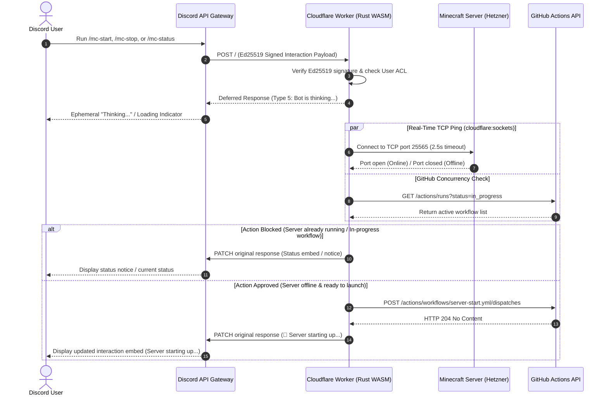

# 🎮 Discord Slash-Command Bot (Rust + Cloudflare Workers)

A serverless Discord slash-command bot written in **Rust** using [`workers-rs`](https://github.com/cloudflare/workers-rs), compiled to WebAssembly, and hosted on **Cloudflare Workers** (100% free tier). It dispatches GitHub Actions workflows (`server-start.yml` and `server-stop.yml`) to provision and destroy your ephemeral Minecraft server on Hetzner Cloud.

---

## 🏗️ Architecture & Interaction Flow



---

## ⚡ Features

* **Zero JS/TS in Runtime**: 100% pure Rust compiled to WebAssembly (`.wasm`) using `edition = "2024"`.
* **Direct TCP Server Ping (Port 25565)**: Pings the server FQDN in real-time over TCP via `cloudflare:sockets` to report actual Minecraft connectivity and guard against starting an already-running server.
* **Instant Interaction Acknowledgement**: Uses Discord's deferred response pattern (`type: 5`) to strictly comply with Discord's 3-second SLA while background TCP pings and workflow dispatches run.
* **Concurrency & Mutex Protection**: Inspects GitHub's Actions API to prevent duplicate starts or conflicts with ongoing workflows.
* **Role / User Access Control**: Restrict operational commands to specific Discord User IDs via `ALLOWED_USER_IDS` in `config/settings.yaml`.
* **Zero 24/7 Hosting Costs**: Runs entirely on Cloudflare Workers (free tier includes 100,000 requests/day).

---

## 📋 Division of Responsibilities: Manual vs. CI Automated

| Responsibility | Type | Description |
|---|---|---|
| **Discord App & Bot Creation** | 🧑‍💻 **Manual (One-Time)** | Create application in Discord Developer Portal; copy `Application ID`, `Public Key`, and `Bot Token`. |
| **Bot Guild Invite** | 🧑‍💻 **Manual (One-Time)** | Invite bot to your Discord server using OAuth2 URL Generator (`bot`, `applications.commands`). |
| **Cloudflare Workers Subdomain** | 🧑‍💻 **Manual (One-Time)** | Initialize your `*.workers.dev` subdomain in the Cloudflare Dashboard. |
| **Secrets Management (SOPS)** | 🧑‍💻 **Manual (One-Time)** | Encrypt Discord credentials & Cloudflare API token in `config/secrets.enc.yaml`. |
| **Enable in Settings** | 🧑‍💻 **Manual (One-Time)** | Set `discord.enabled: true` in `config/settings.yaml`. |
| **Link Interactions Endpoint** | 🧑‍💻 **Manual (One-Time)** | Set `Interactions Endpoint URL` in Discord Portal after first deployment. |
| **Rust Lint & Verification** | 🤖 **Automated (CI)** | Runs `cargo clippy`, `cargo fmt --check`, and `cargo check` on every pull request & push. |
| **Cloudflare Worker Build & Deploy** | 🤖 **Automated (CI)** | Compiles Rust to `.wasm` via `worker-build` and deploys to Cloudflare via `wrangler-action`. |
| **Worker Secrets Sync** | 🤖 **Automated (CI)** | Decrypts SOPS secrets via `SOPS_AGE_KEY` in CI and updates Worker secrets via Wrangler. |
| **Slash Command Registration** | 🤖 **Automated (CI)** | Executes `scripts/register-commands.sh` against Discord REST API when script changes or when triggered via `workflow_dispatch`. |

---

## 🛠️ Step-by-Step Setup Guide

### Step 1: Create a Discord Application & Add Bot to Server

1. Go to the [Discord Developer Portal](https://discord.com/developers/applications) and sign in.
2. Click **New Application** and give it a name (e.g. `Mine Your Own Bum`).
3. On the **General Information** page:
   - Copy the **Application ID**.
   - Copy the **Public Key** (a 64-character hex string used by the Rust worker to verify Ed25519 signatures).
4. In the left sidebar, navigate to **Bot**:
   - Click **Reset Token** and copy your **Bot Token** (used for registering slash commands).
   - *Note on Privileged Gateway Intents*: **Leave all Privileged Gateway Intents disabled.** The bot communicates strictly over serverless HTTP webhooks; it does not maintain persistent WebSocket connections.
5. **Add the Bot to your Discord Server (Guild Invite)**:
   - In the left sidebar, navigate to **OAuth2 → URL Generator**.
   - Under **Scopes**, select both:
     - `bot`
     - `applications.commands` (enables slash commands)
   - Under **Bot Permissions** (the permission checklist appearing below), select:
     - `Send Messages` (and optionally `Embed Links`)
   - Scroll down to the bottom and copy the **Generated URL**.
   - Paste the URL into your browser, select your Discord server from the dropdown, click **Continue**, and then click **Authorize** (complete CAPTCHA if prompted).
   - *Note on Bot Status*: The bot will appear **Offline** in your Discord member list. This is completely expected for serverless webhook-based bots, which wake up on-demand only when a slash command is triggered.

---

### Step 2: Set Up Cloudflare Worker & API Token

1. **Subdomain Setup**:
   - In the [Cloudflare Dashboard](https://dash.cloudflare.com/), navigate to **Workers & Pages**.
   - If this is your first time using Cloudflare Workers, set your desired `*.workers.dev` subdomain (e.g. `my-team.workers.dev`).
2. **Create Initial Worker (Hello World Starter)**:
   - Cloudflare's setup wizard requires creating an initial worker before opening settings or linking CI/CD.
   - Click **Create Application** (or **Create Worker**).
   - Select the **"Hello World"** template.
   - Name the Worker **`minecraft-discord-bot`** (matching `name` in `wrangler.toml`).
     *(If you use a custom name, make sure to update `name = "..."` in `integrations/discord-bot/wrangler.toml` to match).*
   - Click **Deploy**.
   - You now have an active worker and assigned URL: `https://minecraft-discord-bot.<your-subdomain>.workers.dev`.
   - *(CI/CD will compile your Rust code and overwrite the "Hello World" placeholder on first deployment).*
3. **Generate CI/CD API Token (Worker-Scoped)**:
   - On your newly created worker's page, go to **Settings → Builds** (or **CI/CD**).
   - In the **External CI/CD** section, find **API token for external CI/CD** and click **Create Token**.
   - Cloudflare will automatically generate an API token pre-scoped with the exact permissions needed to deploy, build, and set secrets for this worker (analogous to the bucket-scoped "Create Token" button in Cloudflare R2).
   - Copy the generated API token.
   - *(Alternative: You can also create an account-level token under **My Profile → API Tokens → Create Token** using the **Edit Cloudflare Workers** template).*

---

### Step 3: Prepare GitHub Personal Access Token (PAT)

The Cloudflare Worker requires a GitHub PAT to query active workflow runs and dispatch `server-start.yml` and `server-stop.yml`:

* **Fine-Grained PAT (Recommended)**:
  - Repository access: Select your Minecraft server repository.
  - Repository permissions: `Actions: Read and write`.
* **Classic PAT**:
  - Scopes: `repo` (Full control of private repositories) or `workflow`.

*(If you already configured `PAT_WATCHDOG` or `github_pat` for the idle watchdog script, the bot reuses the same token).*

---

### Step 4: Configure Repository Settings & Secrets

#### 1. Enable Discord Bot in `config/settings.yaml`

Edit `config/settings.yaml` to enable the integration:

```yaml
discord:
  enabled: true # Must be true for CI to deploy the worker
  # Optional: Restrict /mc-start and /mc-stop to specific Discord user IDs.
  # Leave empty ([]) to allow all members with slash command access.
  allowed_user_ids:
    - "123456789012345678"
```

#### 2. Store Secrets in SOPS

Add the credentials to `config/secrets.enc.yaml`:

```bash
sops config/secrets.enc.yaml
```

Add or update the following keys:

```yaml
cloudflare_api_token: "<YOUR_CLOUDFLARE_API_TOKEN>"
discord_public_key: "<YOUR_DISCORD_PUBLIC_KEY>"
discord_application_id: "<YOUR_DISCORD_APPLICATION_ID>"
discord_bot_token: "<YOUR_DISCORD_BOT_TOKEN>"
github_pat: "<YOUR_GITHUB_PAT>"
```

*(Alternatively, you can provide these as GitHub Actions repository secrets: `CLOUDFLARE_API_TOKEN`, `DISCORD_PUBLIC_KEY`, `DISCORD_APPLICATION_ID`, `DISCORD_BOT_TOKEN`, and `PAT_WATCHDOG`).*

---

### Step 5: Deploy the Cloudflare Worker

#### Option A: Automated via GitHub Actions (Recommended)

1. Commit and push your changes to `main`:
   ```bash
   git add config/settings.yaml config/secrets.enc.yaml
   git commit -m "feat(discord): enable discord bot integration"
   git push origin main
   ```
2. The `.github/workflows/deploy-discord-bot.yml` workflow will automatically:
   - Check and lint the Rust codebase (`cargo clippy`, `cargo fmt`).
   - Decrypt credentials from SOPS via `SOPS_AGE_KEY`.
   - Compile Rust to WebAssembly with `worker-build`.
   - Synchronize worker secrets and deploy to Cloudflare Workers.

#### Option B: Manual Local Deployment via Wrangler

If deploying directly from your workstation:

```bash
# 1. Install prerequisites (if not already installed)
# - Node.js (v18+)
# - Rust toolchain with WebAssembly target:
rustup target add wasm32-unknown-unknown
cargo install worker-build

# 2. Authenticate with Cloudflare
export CLOUDFLARE_API_TOKEN="your_cloudflare_token"

cd integrations/discord-bot

# 3. Provision worker secrets in Cloudflare
npx wrangler secret put DISCORD_PUBLIC_KEY
npx wrangler secret put DISCORD_APPLICATION_ID
npx wrangler secret put GITHUB_PAT
npx wrangler secret put ALLOWED_USER_IDS  # Optional (comma-separated list)

# 4. Deploy Rust Worker
npx wrangler deploy \
  --var GITHUB_OWNER="your-github-username" \
  --var GITHUB_REPO="your-minecraft-repo" \
  --var SERVER_FQDN="mc.example.com"
```

---

### Step 6: Link Interactions URL in Discord Portal

Once the Worker is deployed, you must register its public endpoint with Discord:

1. Copy your Worker URL from the Cloudflare deployment output:
   `https://minecraft-discord-bot.<your-subdomain>.workers.dev`
2. Open the [Discord Developer Portal](https://discord.com/developers/applications) and select your application.
3. In the **General Information** tab, locate **Interactions Endpoint URL**.
4. Paste your Worker URL and click **Save Changes**.
5. Discord will immediately dispatch a cryptographic `PING` verification request. The Rust Worker verifies the Ed25519 signature and returns `PONG`. A green checkmark confirms verification.

#### 🔍 Troubleshooting "The specified URL could not be verified"

If Discord rejects your endpoint URL, verify the following:

1. **Verify Worker is Live**: Test the endpoint with `curl`:
   ```bash
   curl -i -X POST https://minecraft-discord-bot.<your-subdomain>.workers.dev
   ```
   *Expected response*: HTTP 401 with body `Missing signature header`. (If you receive 404 or 502, the worker is not deployed or the URL is mistyped).
2. **Verify Public Key**: Ensure `DISCORD_PUBLIC_KEY` configured in the Worker secrets matches the **Public Key** on Discord's **General Information** page (not the Application ID, Client Secret, or Bot Token).
3. **Inspect Real-Time Logs**: Run Wrangler's live log tailing while clicking **Save Changes** in Discord:
   ```bash
   cd integrations/discord-bot
   npx wrangler tail
   ```
   You will see incoming POST requests and detailed error traces if signature verification fails.

---

### Step 7: Register Discord Slash Commands

Discord requires slash commands to be explicitly registered via its REST API:

#### Instant Registration for Your Guild (Fastest for Testing)
Global slash commands can take up to an hour to propagate across Discord's CDN, whereas Guild-specific commands are available **instantly**:

```bash
cd integrations/discord-bot
DISCORD_BOT_TOKEN="your_bot_token" \
DISCORD_APPLICATION_ID="your_app_id" \
GUILD_ID="your_discord_server_id" \
./scripts/register-commands.sh
```

*(To find your Guild ID: Enable **Developer Mode** in Discord under User Settings → Advanced, then right-click your Discord server icon and select **Copy Server ID**).*

#### Global Registration
To register commands across all Discord servers where the bot is installed:

```bash
cd integrations/discord-bot
DISCORD_BOT_TOKEN="your_bot_token" \
DISCORD_APPLICATION_ID="your_app_id" \
./scripts/register-commands.sh
```

#### Automated Sync via GitHub Actions
To re-register slash commands through CI:
1. Navigate to **Actions → Deploy Discord Bot** in your GitHub repository.
2. Click **Run workflow**.
3. Check the box **Force synchronize slash commands with Discord**.
4. Click **Run workflow**.

---

## 🎯 Discord Commands & Permissions Reference

| Command | Description | Behavior & Protections |
|---|---|---|
| `/mc-status` | Report real-time server and workflow status | Performs direct TCP ping on port 25565. Queries GitHub Actions API for active provisioning or teardown runs. |
| `/mc-start` | Provision VM & start server | Pings TCP 25565 first; if already online, informs caller without booting duplicate VM. If offline, dispatches `server-start.yml`. |
| `/mc-stop` | Gracefully save world & shut down VM | Checks if server is online; if running, dispatches `server-stop.yml` to save chunks, backup to S3/R2, and destroy the VM. |

### 🔒 Access Control (ACL)

To prevent unauthorized users from starting or stopping the server:

1. Obtain the Discord User ID of authorized players:
   - Enable **Developer Mode** in Discord (`User Settings → Advanced → Developer Mode`).
   - Right-click any user profile and select **Copy User ID**.
2. Add the User IDs to `config/settings.yaml`:
   ```yaml
   discord:
     enabled: true
     allowed_user_ids:
       - "123456789012345678"
       - "987654321098765432"
   ```
3. When unauthorized users run operational commands, the bot responds with an ephemeral message visible only to them:
   `⛔ You do not have permission to manage this Minecraft server.`
4. If `allowed_user_ids` is left empty `[]`, all members in channels where the bot has command permissions may run the commands.

---

## 🛠️ Observability & Monitoring

* **Live Request Streaming**:
  ```bash
  cd integrations/discord-bot
  npx wrangler tail
  ```
* **Cloudflare Analytics**:
  - View requests, CPU execution time, and error rates in the Cloudflare Dashboard under **Workers & Pages → minecraft-discord-bot**.
* **GitHub Actions Logs**:
  - View dispatch events and step-by-step Terraform provisioning in your repository under the **Actions** tab.
