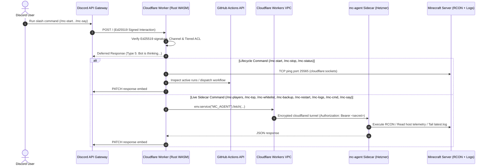

# 🎮 Discord Slash-Command Bot & Sidecar Bridge (Rust + Cloudflare Workers VPC)

A serverless Discord slash-command bot written in **Rust** using [`workers-rs`](https://github.com/cloudflare/workers-rs), compiled to WebAssembly, and hosted on **Cloudflare Workers** (100% free tier — works with your free `*.workers.dev` subdomain, no custom domain required).

It operates in a **hybrid two-path architecture**:
1. **Lifecycle Path (GitHub Actions API)**: Dispatches `server-start.yml` and `server-stop.yml` to provision or destroy the Hetzner VM.
2. **Zero-Trust Sidecar Path (Cloudflare Workers VPC)**: Connects securely over an outbound-only `cloudflared` tunnel to [`mc-agent`](../mc-agent/README.md) on the VM for live RCON commands, host telemetry, sanitized log tailing, and live Discord chat bridging.

---

## 🏗️ Architecture & Interaction Flow



---

## ⚡ Features

* **Zero JS/TS in Runtime**: 100% pure Rust compiled to WebAssembly (`.wasm`) using `edition = "2024"`.
* **Zero Inbound Firewall Exposure**: `mc-agent` runs on an isolated internal Docker network; `cloudflared` dials outbound to Cloudflare edge, so neither RCON (`25575`) nor HTTP (`8080`) is exposed publicly.
* **Free-Tier Cloudflare Workers VPC**: Binds the worker directly to `mc-agent` via `[[vpc_services]]` (`MC_AGENT`) on `*.workers.dev` with no custom domain required.
* **Dual-Channel Separation**: Optionally isolate operational commands in `#mc-commands` (`COMMAND_CHANNEL_ID`) and in-game chat `/mc-say` in `#mc-chat` (`CHAT_CHANNEL_ID`).
* **Tiered Fail-Closed Access Control**: Public/read-only commands and `/mc-say` stay usable for players, while destructive/admin commands (`/mc-whitelist`, `/mc-backup`, `/mc-restart`, `/mc-cmd`) strictly fail closed unless callers are listed in `ALLOWED_USER_IDS`.
* **Direct TCP Server Ping & GitHub Mutex**: Pings port `25565` via `cloudflare:sockets` and inspects GitHub Actions concurrency before starting/stopping.
* **Live Chat Bridge & Boot Notification**: `mc-agent` tails `latest.log` (Vanilla, Fabric, NeoForge, Paper) and pushes chat/join/leave webhooks + boot-ready embeds directly to Discord.

---

## 📋 Division of Responsibilities: Manual vs. CI Automated

| Responsibility | Type | Description |
|---|---|---|
| **Discord App, Bot & Webhooks** | 🧑‍💻 **Manual (One-Time)** | Create application in Discord Developer Portal; create webhooks for `#mc-commands` & `#mc-chat` (and copy Channel IDs if separating channels). |
| **Bot Guild Invite** | 🧑‍💻 **Manual (One-Time)** | Invite bot to your Discord server using OAuth2 URL Generator (`bot`, `applications.commands`). |
| **Cloudflare Worker, Tunnel & VPC** | 🧑‍💻 **Manual (One-Time)** | Set up `*.workers.dev`, create Cloudflare Tunnel (`cloudflared` token) + Workers VPC service (`npx wrangler vpc service create`), and add `[[vpc_services]]` in `wrangler.toml`. |
| **Secrets Management (SOPS)** | 🧑‍💻 **Manual (One-Time)** | Encrypt Discord credentials, `agent_shared_secret`, `cloudflare_tunnel_token`, webhooks, and Cloudflare API token in `config/secrets.enc.yaml`. |
| **Enable in Settings** | 🧑‍💻 **Manual (One-Time)** | Set `discord.enabled: true` (and optional channel IDs / `allowed_user_ids`) in `config/settings.yaml`. |
| **Link Interactions Endpoint** | 🧑‍💻 **Manual (One-Time)** | Set `Interactions Endpoint URL` in Discord Portal after first deployment. |
| **Rust Lint & Verification** | 🤖 **Automated (CI)** | Runs `cargo clippy`, `cargo fmt --check`, `cargo test`, and `cargo check` on every pull request & push. |
| **Cloudflare Worker Build & Deploy** | 🤖 **Automated (CI)** | Compiles Rust to `.wasm` via `worker-build` and deploys to Cloudflare via `lights-camera-bum-action`. |
| **Worker Secrets Sync** | 🤖 **Automated (CI)** | Decrypts SOPS secrets via `SOPS_AGE_KEY` in CI and updates Worker secrets (`AGENT_SHARED_SECRET`, etc.) via Wrangler. |
| **Slash Command Registration** | 🤖 **Automated (CI)** | Executes `scripts/register-commands.sh` (all 11 slash commands) against Discord REST API when script changes or when triggered manually. |

---

## 🛠️ Step-by-Step Setup Guide

### Step 1: Create a Discord Application & Add Bot to Server

1. Go to the [Discord Developer Portal](https://discord.com/developers/applications) and sign in.
2. Click **New Application** and give it a name (e.g. `Mine Your Own Bum`).
3. On the **General Information** page:
   - Copy the **Application ID**.
   - Copy the **Public Key** (a 64-character hex string used by the Rust worker to verify Ed25519 signatures).
4. In the left sidebar, navigate to **Bot**:
   - Click **Reset Token** and copy your **Bot Token** (used for registering slash commands).
   - *Note on Privileged Gateway Intents*: **Leave all Privileged Gateway Intents disabled.** The bot communicates strictly over serverless HTTP webhooks; it does not maintain persistent WebSocket connections.
5. **Add the Bot to your Discord Server (Guild Invite)**:
   - In the left sidebar, navigate to **OAuth2 → URL Generator**.
   - Under **Scopes**, select both:
     - `bot`
     - `applications.commands` (enables slash commands)
   - Under **Bot Permissions** (the permission checklist appearing below), select:
     - `Send Messages` (and optionally `Embed Links`)
   - Scroll down to the bottom and copy the **Generated URL**.
   - Paste the URL into your browser, select your Discord server from the dropdown, click **Continue**, and then click **Authorize** (complete CAPTCHA if prompted).
   - *Note on Bot Status*: The bot will appear **Offline** in your Discord member list. This is completely expected for serverless webhook-based bots, which wake up on-demand only when a slash command is triggered.

---

### Step 2: Set Up Cloudflare Worker & API Token

1. **Subdomain Setup**:
   - In the [Cloudflare Dashboard](https://dash.cloudflare.com/), navigate to **Workers & Pages**.
   - If this is your first time using Cloudflare Workers, set your desired `*.workers.dev` subdomain (e.g. `my-team.workers.dev`).
2. **Create Initial Worker (Hello World Starter)**:
   - Cloudflare's setup wizard requires creating an initial worker before opening settings or linking CI/CD.
   - Click **Create Application** (or **Create Worker**).
   - Select the **"Hello World"** template.
   - Name the Worker **`minecraft-discord-bot`** (matching `name` in `wrangler.toml`).
     *(If you use a custom name, make sure to update `name = "..."` in `integrations/discord-bot/wrangler.toml` to match).*
   - Click **Deploy**.
   - You now have an active worker and assigned URL: `https://minecraft-discord-bot.<your-subdomain>.workers.dev`.
   - *(CI/CD will compile your Rust code and overwrite the "Hello World" placeholder on first deployment).*
3. **Generate CI/CD API Token (Worker-Scoped or Account-Scoped)**:
   - On your newly created worker's page, go to **Settings → Builds** (or **CI/CD**) → **External CI/CD** → **API token for external CI/CD** → **Create Token** (or create an account token under **My Profile → API Tokens** with **Edit Cloudflare Workers** + **Cloudflare Tunnel: Edit** + **Workers VPC: Edit** if managing tunnels/VPC via CLI).
   - Copy the generated API token (`cloudflare_api_token`).
4. **Create Cloudflare Tunnel & Workers VPC Service *(Zero-Trust Sidecar Bridge, Free Tier)***:
   > [!NOTE]
   > Cloudflare Workers VPC works directly on your free `*.workers.dev` worker without purchasing or transferring a custom domain to Cloudflare.
   1. In the Cloudflare Dashboard, open **Workers & Pages → Workers VPC → Tunnels** (or **Zero Trust → Networks → Tunnels**):
      - Click **Create a tunnel** → choose **Cloudflared** → name it (e.g. `mc-agent-tunnel`).
      - Copy the **Tunnel Connector Token** (starts with `eyJ...`) for `cloudflare_tunnel_token` in SOPS, and note the **Tunnel UUID** (you do **not** need to configure Public Hostnames).
   2. Register a **Workers VPC Service** pointing to `mc-agent:8080` on that tunnel:
      ```bash
      npx wrangler login
      npx wrangler vpc service create mc-agent \
        --type http \
        --tunnel-id <YOUR_TUNNEL_UUID> \
        --hostname mc-agent \
        --http-port 8080
      ```
      Copy the returned **`Service ID`** (`service_id`).
   3. Bind the VPC service in `integrations/discord-bot/wrangler.toml`:
      ```toml
      [[vpc_services]]
      binding = "MC_AGENT"
      service_id = "<YOUR_VPC_SERVICE_ID>"
      remote = true
      ```
5. **Create Discord Channel Webhooks & Copy Channel IDs *(For Chat Bridge & Boot Notification)***:
   - Enable **Developer Mode** in Discord (`User Settings → Advanced → Developer Mode`).
   - Create two channels (recommended): e.g. `#mc-commands` and `#mc-chat`.
   - Right-click each channel → **Copy Channel ID** (used for `discord.command_channel_id` and `discord.chat_channel_id`).
   - In each channel: **Edit Channel → Integrations → Webhooks → New Webhook → Copy Webhook URL**:
     - `#mc-chat` Webhook URL → `discord_chat_webhook_url` (live player chat, joins, leaves).
     - `#mc-commands` Webhook URL → `discord_command_webhook_url` (rich "Server Online & Ready" boot embeds; falls back to `discord_chat_webhook_url` if omitted).
6. **Generate Shared Bearer Secret**:
   ```bash
   openssl rand -hex 32
   ```
   Save this random hex token as `agent_shared_secret` in SOPS (shared between the Worker and `mc-agent`).

---

### Step 3: Prepare GitHub Personal Access Token (PAT)

The Cloudflare Worker requires a GitHub PAT to query active workflow runs and dispatch `server-start.yml` and `server-stop.yml`:

* **Fine-Grained PAT (Recommended)**:
  - Repository access: Select your Minecraft server repository.
  - Repository permissions: `Actions: Read and write`.
* **Classic PAT**:
  - Scopes: `repo` (Full control of private repositories) or `workflow`.

*(If you already configured `PAT_WATCHDOG` or `github_pat` for the idle watchdog script, the bot reuses the same token).*

---

### Step 4: Configure Repository Settings & Secrets

#### 1. Enable Discord Bot & Channels in `config/settings.yaml`

Edit `config/settings.yaml` to enable the integration:

```yaml
discord:
  enabled: true # Must be true for CI to deploy the worker
  # Optional: Separate #mc-commands (operational/admin commands) from #mc-chat (/mc-say & live chat)
  command_channel_id: "111111111111111111"
  chat_channel_id: "222222222222222222"
  # Required for mutating admin commands (/mc-whitelist, /mc-backup, /mc-restart, /mc-cmd).
  # Also restricts /mc-start and /mc-stop when populated.
  allowed_user_ids:
    - "123456789012345678"
```

#### 2. Store Secrets in SOPS

Add the credentials to `config/secrets.enc.yaml`:

```bash
sops config/secrets.enc.yaml
```

Add or update the following keys:

```yaml
cloudflare_api_token: "<YOUR_CLOUDFLARE_API_TOKEN>"
discord_public_key: "<YOUR_DISCORD_PUBLIC_KEY>"
discord_application_id: "<YOUR_DISCORD_APPLICATION_ID>"
discord_bot_token: "<YOUR_DISCORD_BOT_TOKEN>"
github_pat: "<YOUR_GITHUB_PAT>"
# Zero-Trust Sidecar Agent & Webhooks
cloudflare_tunnel_token: "<YOUR_CLOUDFLARE_TUNNEL_CONNECTOR_TOKEN>"
agent_shared_secret: "<YOUR_64_CHAR_HEX_SHARED_SECRET>"
discord_chat_webhook_url: "https://discord.com/api/webhooks/..."
discord_command_webhook_url: "https://discord.com/api/webhooks/..."
```

*(Alternatively, Worker secrets `CLOUDFLARE_API_TOKEN`, `DISCORD_PUBLIC_KEY`, `DISCORD_APPLICATION_ID`, `DISCORD_BOT_TOKEN`, `AGENT_SHARED_SECRET`, and `PAT_WATCHDOG` can be provided via GitHub Actions repository secrets.)*

---

### Step 5: Deploy the Cloudflare Worker

#### Option A: Automated via GitHub Actions (Recommended)

1. Commit and push your changes to `main`:
   ```bash
   git add config/settings.yaml config/secrets.enc.yaml
   git commit -m "feat(discord): enable discord bot integration"
   git push origin main
   ```
2. The `.github/workflows/deploy-discord-bot.yml` workflow will automatically:
   - Check and lint the Rust codebase (`cargo clippy`, `cargo fmt`).
   - Decrypt credentials from SOPS via `SOPS_AGE_KEY`.
   - Compile Rust to WebAssembly with `worker-build`.
   - Synchronize worker secrets and deploy to Cloudflare Workers.

#### Option B: Manual Local Deployment via Wrangler

If deploying directly from your workstation:

```bash
# 1. Install prerequisites (if not already installed)
# - Node.js (v18+)
# - Rust toolchain with WebAssembly target:
rustup target add wasm32-unknown-unknown
cargo install worker-build

# 2. Authenticate with Cloudflare
export CLOUDFLARE_API_TOKEN="your_cloudflare_token"

cd integrations/discord-bot

# 3. Provision worker secrets in Cloudflare
npx wrangler secret put DISCORD_PUBLIC_KEY
npx wrangler secret put DISCORD_APPLICATION_ID
npx wrangler secret put GITHUB_PAT
npx wrangler secret put AGENT_SHARED_SECRET
npx wrangler secret put ALLOWED_USER_IDS  # Optional (comma-separated list)

# 4. Deploy Rust Worker
npx wrangler deploy \
  --var GITHUB_OWNER="your-github-username" \
  --var GITHUB_REPO="your-minecraft-repo" \
  --var SERVER_FQDN="mc.example.com" \
  --var COMMAND_CHANNEL_ID="111111111111111111" \
  --var CHAT_CHANNEL_ID="222222222222222222"
```

---

### Step 6: Link Interactions URL in Discord Portal

Once the Worker is deployed, you must register its public endpoint with Discord:

1. Copy your Worker URL from the Cloudflare deployment output:
   `https://minecraft-discord-bot.<your-subdomain>.workers.dev`
2. Open the [Discord Developer Portal](https://discord.com/developers/applications) and select your application.
3. In the **General Information** tab, locate **Interactions Endpoint URL**.
4. Paste your Worker URL and click **Save Changes**.
5. Discord will immediately dispatch a cryptographic `PING` verification request. The Rust Worker verifies the Ed25519 signature and returns `PONG`. A green checkmark confirms verification.

#### 🔍 Troubleshooting "The specified URL could not be verified"

If Discord rejects your endpoint URL, verify the following:

1. **Verify Worker is Live**: Test the endpoint with `curl`:
   ```bash
   curl -i -X POST https://minecraft-discord-bot.<your-subdomain>.workers.dev
   ```
   *Expected response*: HTTP 401 with body `Missing signature header`. (If you receive 404 or 502, the worker is not deployed or the URL is mistyped).
2. **Verify Public Key**: Ensure `DISCORD_PUBLIC_KEY` configured in the Worker secrets matches the **Public Key** on Discord's **General Information** page (not the Application ID, Client Secret, or Bot Token).
3. **Inspect Real-Time Logs**: Run Wrangler's live log tailing while clicking **Save Changes** in Discord:
   ```bash
   cd integrations/discord-bot
   npx wrangler tail
   ```
   You will see incoming POST requests and detailed error traces if signature verification fails.

---

### Step 7: Register Discord Slash Commands

Discord requires slash commands to be explicitly registered via its REST API:

#### Instant Registration for Your Guild (Fastest for Testing)
Global slash commands can take up to an hour to propagate across Discord's CDN, whereas Guild-specific commands are available **instantly**:

```bash
cd integrations/discord-bot
DISCORD_BOT_TOKEN="your_bot_token" \
DISCORD_APPLICATION_ID="your_app_id" \
GUILD_ID="your_discord_server_id" \
./scripts/register-commands.sh
```

*(To find your Guild ID: Enable **Developer Mode** in Discord under User Settings → Advanced, then right-click your Discord server icon and select **Copy Server ID**).*

#### Global Registration
To register commands across all Discord servers where the bot is installed:

```bash
cd integrations/discord-bot
DISCORD_BOT_TOKEN="your_bot_token" \
DISCORD_APPLICATION_ID="your_app_id" \
./scripts/register-commands.sh
```

#### Automated Sync via GitHub Actions
To re-register slash commands through CI:
1. Navigate to **Actions → Deploy Discord Bot** in your GitHub repository.
2. Click **Run workflow**.
3. Check the box **Force synchronize slash commands with Discord**.
4. Click **Run workflow**.

---

## 🎯 Discord Commands & Permissions Reference

| Command | Channel Scope | Permission Tier | Description & Behavior |
|---|---|---|---|
| `/mc-status` | `#mc-commands` | Public / Open | Pings TCP `25565`, queries GitHub Actions for active start/stop runs, and reports direct IP + connect info. |
| `/mc-start` | `#mc-commands` | Lifecycle (`ALLOWED_USER_IDS` if non-empty, else open) | Verifies server is offline and no workflow is running, then dispatches `server-start.yml`. |
| `/mc-stop` | `#mc-commands` | Lifecycle (`ALLOWED_USER_IDS` if non-empty, else open) | Dispatches `server-stop.yml` to save world chunks, run off-site backup (if enabled), and destroy the VM. |
| `/mc-players` | `#mc-commands` | Public / Open | Queries `mc-agent` via Workers VPC (`RCON list`) and displays online player count & names. |
| `/mc-top` | `#mc-commands` | Public / Open | Displays host CPU load averages, RAM usage, world `/data` disk usage, uptime, and player count. |
| `/mc-logs [lines]` | `#mc-commands` | Public / Open | Fetches the last `1–80` (default `40`) lines of `latest.log` with ANSI codes stripped and IPv4 addresses redacted. |
| `/mc-say <message>` | `#mc-chat` | Public / Open | Broadcasts `[Discord] <user>: <message>` into in-game chat using JSON-escaped `tellraw`. |
| `/mc-whitelist <add\|remove\|list>` | `#mc-commands` | **Admin Only (Fail-Closed)** | Validates Minecraft player names and manages the server whitelist live via RCON (`whitelist add/remove/list`). |
| `/mc-backup` | `#mc-commands` | **Admin Only (Fail-Closed)** | Runs `save-all flush` via RCON to persist dirty chunks cleanly to the persistent block volume. |
| `/mc-restart` | `#mc-commands` | **Admin Only (Fail-Closed)** | Issues `stop` via RCON so Docker cleanly shuts down the JVM and restarts the Minecraft container without destroying the VM. |
| `/mc-cmd <command>` | `#mc-commands` | **Admin Only (Fail-Closed)** | Executes an arbitrary server console command via RCON (without leading slash). |

### 🔀 Channel Separation

When `command_channel_id` and/or `chat_channel_id` are configured in `config/settings.yaml`:
* `/mc-say` is restricted to `CHAT_CHANNEL_ID` (`#mc-chat`), alongside automated live player chat/join/leave webhooks.
* All other commands (`/mc-start`, `/mc-stop`, `/mc-status`, `/mc-players`, `/mc-top`, `/mc-logs`, `/mc-whitelist`, `/mc-backup`, `/mc-restart`, `/mc-cmd`) are restricted to `COMMAND_CHANNEL_ID` (`#mc-commands`).
* Running a command in the wrong channel returns an ephemeral notice telling the caller which channel to use.

### 🔒 Tiered Access Control (ACL)

1. Obtain the Discord User ID of authorized admins/operators:
   - Enable **Developer Mode** in Discord (`User Settings → Advanced → Developer Mode`).
   - Right-click any user profile and select **Copy User ID**.
2. Add the User IDs to `config/settings.yaml`:
   ```yaml
   discord:
     enabled: true
     allowed_user_ids:
       - "123456789012345678"
       - "987654321098765432"
   ```
3. **Authorization Behavior**:
   - **Public Commands** (`/mc-status`, `/mc-players`, `/mc-top`, `/mc-logs`, `/mc-say`): Always allowed (respecting channel restrictions).
   - **Lifecycle Commands** (`/mc-start`, `/mc-stop`): Restricted to `allowed_user_ids` when populated; open to channel members when `allowed_user_ids` is empty (`[]`).
   - **Admin Commands** (`/mc-whitelist`, `/mc-backup`, `/mc-restart`, `/mc-cmd`): **Strictly fail closed** — if `allowed_user_ids` is empty (`[]`), **every caller is denied** until at least one admin Discord User ID is configured.
4. Unauthorized callers receive an ephemeral rejection visible only to them:
   `⛔ You do not have permission to execute this command.`

---

## 🛠️ Observability & Monitoring

* **Live Request Streaming**:
  ```bash
  cd integrations/discord-bot
  npx wrangler tail
  ```
* **Cloudflare Analytics**:
  - View requests, CPU execution time, and error rates in the Cloudflare Dashboard under **Workers & Pages → minecraft-discord-bot**.
* **GitHub Actions Logs**:
  - View dispatch events and step-by-step Terraform provisioning in your repository under the **Actions** tab.
